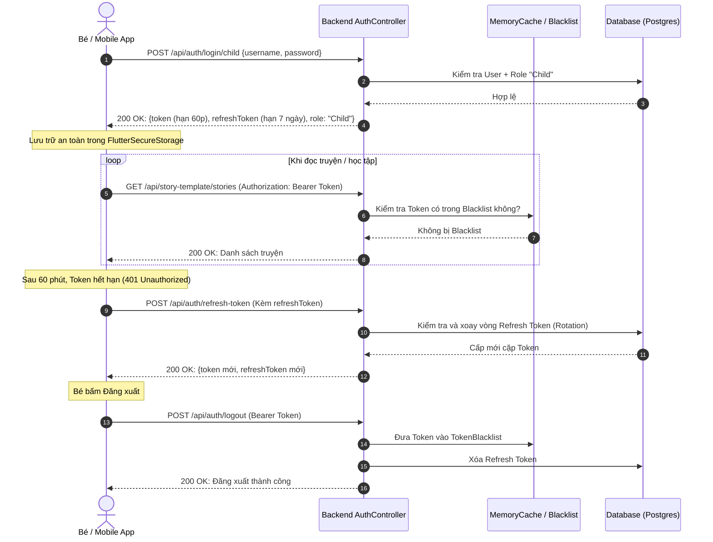
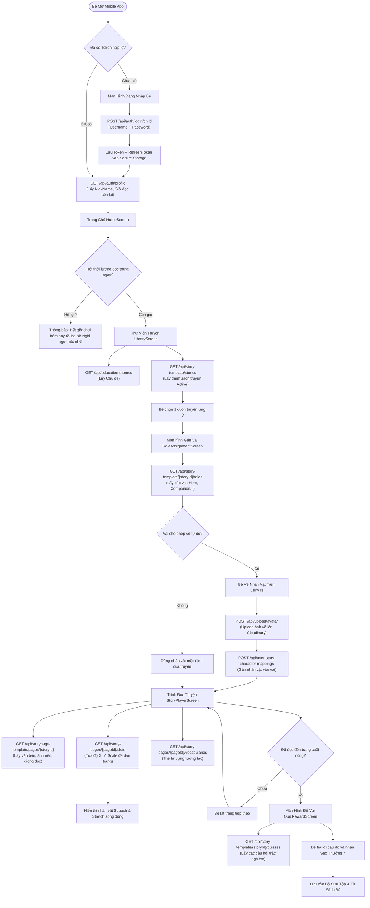

# 📱 TÀI LIỆU HƯỚNG DẪN TÍCH HỢP HỆ THỐNG API DÀNH CHO MOBILE APP (CHILD FLOW)
> **Dự án:** SketchTale - Nền Tảng Đọc Truyện Tương Tác & Sáng Tạo Nghệ Thuật Cho Trẻ Em  
> **Kiến trúc Backend:** .NET 8 Web API (Clean Architecture, ASP.NET Identity, Entity Framework Core, PostgreSQL)  
> **Nền tảng Client:** Flutter Mobile App (Android, iOS & Tablet/iPad)  
> **Đối tượng người dùng chính:** **Trẻ em (Role: `Child`)**  
> **Múi giờ chuẩn:** UTC+7 (Giờ Việt Nam) | **Định dạng dữ liệu:** JSON & Multipart Form-Data  
> **Cập nhật:** Tháng 10/2026  

---

## 📑 MỤC LỤC

1. [Tổng Quan & Cấu Hình Môi Trường](#1-tổng-quan--cấu-hình-môi-trường)
   - 1.1. Thông tin kết nối & Base URL
   - 1.2. Headers mặc định
   - 1.3. Tài khoản thử nghiệm (Seed Accounts)
2. [Cơ Chế Xác Thực & Phân Quyền (Auth & RBAC cho Child)](#2-cơ-chế-xác-thực--phân-quyền-auth--rbac-cho-child)
   - 2.1. Đặc thù tài khoản Trẻ Em (Child Identity)
   - 2.2. Chu kỳ hoạt động của JWT Token & Refresh Token Rotation
   - 2.3. Cơ chế thu hồi Token (Token Blacklist khi Logout)
   - 2.4. Ma trận phân quyền: Trẻ Em (`Child`) vs Phụ Huynh (`Parent`)
3. [Bảng Tra Cứu Enums Chuẩn Hóa (Backend to Flutter Cheat Sheet)](#3-bảng-tra-cứu-enums-chuẩn-hóa)
4. [Sơ Đồ Luồng Nghiệp Vụ Trải Nghiệm Của Bé (Child User Journey)](#4-sơ-đồ-luồng-nghiệp-vụ-trải-nghiệm-của-bé)
5. [Chi Tiết Toàn Bộ APIs Theo Từng Luồng Nghiệp Vụ Mobile](#5-chi-tiết-toàn-bộ-apis-theo-từng-luồng-nghiệp-vụ-mobile)
   - [Luồng 1: Xác Thực & Phiên Đăng Nhập Của Bé](#luồng-1-xác-thực--phiên-đăng-nhập-của-bé)
   - [Luồng 2: Hồ Sơ Cá Nhân & Quản Trị Giới Hạn Của Bé](#luồng-2-hồ-sơ-cá-nhân--quản-trị-giới-hạn-của-bé)
   - [Luồng 3: Khám Phá Thư Viện Truyện Theo Độ Tuổi & Chủ Đề](#luồng-3-khám-phá-thư-viện-truyện-theo-độ-tuổi--chủ-đề)
   - [Luồng 4: Phân Vai Nhân Vật & Sáng Tạo Bản Vẽ](#luồng-4-phân-vai-nhân-vật--sáng-tạo-bản-vẽ)
   - [Luồng 5: Trình Đọc Truyện Tương Tác & Dàn Trang Nhân Vật 3D/Squash](#luồng-5-trình-đọc-truyện-tương-tác--dàn-trang-nhân-vật-3dsquash)
   - [Luồng 6: Học Từ Vựng Tương Tác Theo Ngữ Cảnh](#luồng-6-học-từ-vựng-tương-tác-theo-ngữ-cảnh)
   - [Luồng 7: Đố Vui Nhận Thưởng Sau Khi Đọc Truyện (Quiz & Stars)](#luồng-7-đố-vui-nhận-thưởng-sau-khi-đọc-truyện-quiz--stars)
   - [Luồng 8: Báo Cáo Nội Dung Bất Thường (Child Safety / Report)](#luồng-8-báo-cáo-nội-dung-bất-thường-child-safety--report)
6. [Quy Chuẩn Xử Lý Lỗi & Fallback Dữ Liệu Ngoại Tuyến (Offline Resilience)](#6-quy-chuẩn-xử-lý-lỗi--fallback-dữ-liệu-ngoại-tuyến)
7. [Mã Nguồn Mẫu Hoàn Chỉnh Cho Flutter (Dart Services & Interceptors)](#7-mã-nguồn-mẫu-hoàn-chỉnh-cho-flutter)
8. [Checklist Kiểm Thử Tích Hợp (Testing & Verification Checklist)](#8-checklist-kiểm-thử-tích-hợp)

---

## 1. TỔNG QUAN & CẤU HÌNH MÔI TRƯỜNG

### 1.1. Thông Tin Kết Nối & Base URL
- **Production / Staging Server:** `https://sketch-tale-be.onrender.com`
- **Local Dev Server (Chạy trên máy trạm):** `http://localhost:8080` (hoặc `http://localhost:5000`)
- **Android Emulator Local:** `http://10.0.2.2:8080` (Cổng nối từ Emulator Android vào máy trạm)
- **iOS Simulator Local:** `http://localhost:8080`
- **Thiết bị thật (Real Device via Wi-Fi):** `http://<IP_MÁY_TÍNH_CỦA_BẠN>:8080` (Ví dụ: `http://192.168.1.15:8080`)
- **Swagger Documentation:** `http://localhost:8080/swagger`

> [!TIP]
> Trong Flutter, cấu hình Base URL tập trung qua file `.env` hoặc lớp [AppConfig](file:///d:/SkectTable/lib/utils/app_config.dart). Khi build release, ứng dụng tự động trỏ về `https://sketch-tale-be.onrender.com`.

### 1.2. Headers Mặc Định

| Tên Header | Giá Trị Mẫu | Mục Đích Sử Dụng |
| :--- | :--- | :--- |
| `Content-Type` | `application/json` | Gửi dữ liệu JSON (Đăng nhập, gán vai, lưu cài đặt, báo cáo) |
| `Content-Type` | `multipart/form-data` | Gửi file ảnh vẽ, avatar nhân vật qua [UploadController](file:///D:/SkectTable/sketch-tale-backend-main/sketch-tale-backend-main/sketch_tale.API/Controllers/UploadController.cs) |
| `Accept` | `application/json` | Bắt buộc để máy chủ luôn phản hồi dữ liệu dạng JSON chuẩn |
| `Authorization` | `Bearer <JWT_ACCESS_TOKEN>` | Bắt buộc đối với tất cả các API yêu cầu xác thực vai trò bé |

### 1.3. Tài Khoản Thử Nghiệm (Seed Accounts)
Cơ sở dữ liệu Backend đã nạp sẵn các tài khoản để đội Mobile kiểm thử:

| Vai Trò (Role) | Username | Password | Email | Ghi Chú Dành Cho Mobile |
| :--- | :--- | :--- | :--- | :--- |
| **Child** | `child` | `Child@123` | *Không có* | **Tài khoản chính để test luồng bé** |
| **Parent** | `parent` | `Parent@123` | `parent@sketch.tale.com` | Dùng để test tạo con hoặc đổi giới hạn |
| **Content Manager** | `manager` | `Manager@123` | `manager@sketch.tale.com` | Dùng để quản trị truyện, câu hỏi, từ vựng |
| **Admin** | `admin` | `Admin@123` | `admin@sketch.tale.com` | Quản trị toàn hệ thống |

---

## 2. CƠ CHẾ XÁC THỰC & PHÂN QUYỀN (AUTH & RBAC CHO CHILD)

### 2.1. Đặc Thù Tài Khoản Trẻ Em (Child Identity)
1. **Không sử dụng Email:** Để bảo vệ quyền riêng tư của trẻ em (tuân thủ COPPA), tài khoản trẻ em **hoàn toàn không có Email**.
2. **Cổng Đăng Nhập Riêng Biệt:** Trẻ em chỉ đăng nhập qua cổng chuyên biệt:
   - Endpoint: `POST /api/auth/login/child`
   - Chỉ truyền `Username` và `Password` (hoặc mã PIN do phụ huynh cấp).
3. **Phụ huynh khởi tạo tài khoản:** Trẻ em **không tự đăng ký** tài khoản ngoài màn hình chào mừng. Phụ huynh sau khi đăng nhập tài khoản của mình sẽ gọi `POST /api/auth/register/child` để sinh hồ sơ bé, thiết lập `NickName`, `Username`, `Password`, và liên kết vào `ParentProfile`.

### 2.2. Chu Kỳ Hoạt Động Của JWT Token & Refresh Token Rotation


- **Thời hạn Access Token:** **60 phút**.
- **Thời hạn Refresh Token:** **7 ngày**.
- **Cơ chế Refresh Token:** Khi nhận mã phản hồi `401 Unauthorized` từ bất kỳ request nào, Client tự động gọi `POST /api/auth/refresh-token` với body `{"refreshToken": "..."}` hoặc header Bearer Token cũ. Backend sẽ kiểm tra và cấp phát cặp Token mới.

### 2.3. Cơ Chế Thu Hồi Token (Token Blacklist)
- Khi bé hoặc phụ huynh bấm nút **Đăng xuất (Logout)** trên Mobile:
  - Mobile gọi `POST /api/auth/logout` với Bearer Token hiện hành.
  - Backend lập tức đưa JTI/Token đó vào danh sách đen `TokenBlacklist` (lưu trên `IMemoryCache` với thời gian tồn tại bằng thời gian còn lại của token).
  - Mọi request sử dụng token cũ này sau đó đều bị chặn tức thì với lỗi `401 Unauthorized`.

### 2.4. Ma Trận Phân Quyền: Trẻ Em (`Child`) vs Phụ Huynh (`Parent`)

| Chức Năng / Phân Hệ | Quyền Của Bé (`Child`) | Quyền Của Phụ Huynh (`Parent`) | Ghi Chú Phía Mobile |
| :--- | :---: | :---: | :--- |
| **Đăng nhập** | `POST /api/auth/login/child` | `POST /api/auth/login` | Bé chỉ dùng Username + Mật khẩu |
| **Tạo tài khoản bé** | ❌ Không có quyền | ✅ `POST /api/auth/register/child` | Phụ huynh tạo cho bé trong mục quản lý con |
| **Xem hồ sơ bé** | ✅ `GET /api/child-profiles/{id}` | ✅ Toàn quyền xem danh sách con | Dùng hiển thị tên, sao thưởng, giờ còn lại |
| **Đổi giới hạn giờ & số nhân vật** | ❌ Bị chặn (403 Forbidden) | ✅ `PUT /api/child-profiles/{id}` | Phụ huynh cài đặt thời lượng đọc sách/ngày |
| **Xem kho truyện mẫu** | ✅ Đọc truyện Active (`/stories`) | ✅ Đọc truyện Active (`/stories`) | Bé chỉ xem truyện đã xuất bản |
| **Xem trang & tọa độ nhân vật** | ✅ `GET /pages`, `GET /slots` | ✅ `GET /pages`, `GET /slots` | Tự động dàn trang nhân vật vẽ |
| **Tự vẽ & upload avatar nhân vật**| ✅ `POST /api/upload/avatar` | ✅ Toàn quyền | Bé vẽ và tải lên ảnh nhân vật của mình |
| **Gán nhân vật vào vai truyện** | ✅ `POST /api/user-story-character-mappings` | ✅ Toàn quyền duyệt/gán | Nếu vai cần duyệt (`requiresParentApproval`), trạng thái là Pending |
| **Học từ vựng & chơi Quiz** | ✅ `GET /vocabularies`, `GET /quizzes` | ✅ Xem câu hỏi & câu đố | Bé tương tác nhận sao thưởng |
| **Mua gói cước / nạp Credit** | ❌ Không có quyền | ✅ Toàn quyền (`/api/subscriptions`) | Ẩn hoàn toàn trên giao diện Child |

---

## 3. BẢNG TRA CỨU ENUMS CHUẨN HÓA

Định nghĩa Enums được đồng bộ chính xác giữa mã nguồn C# Backend (`sketch_tale.Domain.Enums`) và Flutter Dart ([backend_enums.dart](file:///d:/SkectTable/lib/models/backend_enums.dart)):

### 3.1. Trạng Thái Chung (`CommonStatus`)
Áp dụng cho StoryTemplate, StoryPage, StoryRole, StoryQuiz, CharacterSlot.
```csharp
// Backend C# (DomainEnums.cs)
public enum CommonStatus { Draft = 0, Pending = 1, Active = 2, Inactive = 3, Archived = 4 }
```
> [!IMPORTANT]
> **Mobile App chỉ được hiển thị các truyện và nội dung có `status == 2` (`Active`)!**  
> Các API `/api/story-template/stories` và `/api/story-template/{storyId}/quizzes` phía backend đã được cấu hình tự động lọc nội dung Active dành riêng cho Role Child.

### 3.2. Nhóm Tuổi Độc Giả (`TargetAgeGroup`)
Dùng để phân loại sách trong Thư viện truyện và gợi ý sách phù hợp với lứa tuổi của bé:
```csharp
public enum TargetAgeGroup
{
    Ag6to7 = 0,   // Trẻ từ 6 - 7 tuổi (Mầm non lớn, Lớp 1)
    Age8to10 = 1, // Trẻ từ 8 - 10 tuổi (Tiểu học cơ sở)
    Age11to12 = 2 // Trẻ từ 11 - 12 tuổi (Tiểu học lớn)
}
```

### 3.3. Trình Độ Đọc (`ReadingLevel`)
```csharp
public enum ReadingLevel
{
    Beginner = 0,     // Mới bắt đầu đọc (Nhiều tranh, ít chữ)
    Intermediate = 1, // Đọc hiểu cơ bản (Có hội thoại và từ vựng)
    Advanced = 2      // Nâng cao (Cốt truyện phiêu lưu phức tạp)
}
```

### 3.4. Loại Vai Diễn Trong Truyện (`StoryRoleType`)
```csharp
public enum StoryRoleType
{
    MainCharacter = 0, // Nhân vật chính (Hero / Dũng sĩ)
    Companion = 1,     // Bạn đồng hành (Sidekick / Bạn thân)
    Supporting = 2,    // Nhân vật phụ (Bác bảo vệ, Cô tiên)
    Other = 3          // Khác
}
```

### 3.5. Trạng Thái Phụ Huynh Duyệt Nhân Vật (`ParentApprovalStatus`)
```csharp
public enum ParentApprovalStatus
{
    NotRequired = 0, // Vai diễn an toàn, bé vẽ xong được vào truyện ngay
    Pending = 1,     // Đang chờ phụ huynh xem lại bản vẽ
    Approved = 2,    // Đã được phụ huynh duyệt cho phép xuất hiện
    Rejected = 3     // Bị phụ huynh từ chối (bản vẽ không phù hợp)
}
```

---

## 4. SƠ ĐỒ LUỒNG NGHIỆP VỤ TRẢI NGHIỆM CỦA BÉ

Dưới đây là hành trình tương tác liền mạch từ lúc bé mở Mobile App đến khi hoàn thành buổi đọc truyện:



---

## 5. CHI TIẾT TOÀN BỘ APIS THEO TỪNG LUỒNG NGHIỆP VỤ MOBILE

### LUỒNG 1: XÁC THỰC & PHIÊN ĐĂNG NHẬP CỦA BÉ

#### 1.1. Đăng Nhập Tài Khoản Trẻ Em
- **Mục đích:** Đăng nhập ứng dụng chỉ bằng Tên người dùng và Mật khẩu (Không cần Email).
- **Endpoint:** `POST /api/auth/login/child`
- **Yêu cầu quyền:** Công khai (Không cần Token).
- **Request Body:**
```json
{
  "username": "child",
  "password": "Child@123"
}
```
- **Response thành công (`200 OK`):**
```json
{
  "data": {
    "token": "eyJhbGciOiJIUzI1NiIsInR5cCI6IkpXVCJ9...",
    "refreshToken": "48b6c0e8-0974-4b52-9b21-4fa3b01859c2",
    "username": "child",
    "email": null,
    "role": "Child"
  },
  "message": "Đăng nhập trẻ em thành công!"
}
```
- **Xử lý lỗi thường gặp:**
  - `401 Unauthorized`: `"Username hoặc mật khẩu không chính xác!"` hoặc `"Cổng đăng nhập này chỉ dành riêng cho tài khoản trẻ em!"`.
  - `400 Bad Request`: Thiếu thông tin bắt buộc.

#### 1.2. Làm Mới Token Tự Động (Refresh Token Rotation)
- **Mục đích:** Cấp lại Access Token mới khi token 60 phút cũ vừa hết hạn mà không bắt bé phải đăng nhập lại.
- **Endpoint:** `POST /api/auth/refresh-token`
- **Header:** `Authorization: Bearer <EXPIRED_TOKEN>` (Backend cấu hình validator bỏ qua hạn với endpoint này).
- **Request Body (Tùy chọn):**
```json
{
  "refreshToken": "48b6c0e8-0974-4b52-9b21-4fa3b01859c2"
}
```
- **Response thành công (`200 OK`):**
```json
{
  "data": {
    "token": "eyJhbGciOiJIUzI1NiIsInR5cCI6IkpXVCJ9...<TOKEN_MỚI>",
    "refreshToken": "72f1a89c-33b1-4cd4-b81f-81829e120199",
    "username": "child",
    "email": null,
    "role": "Child"
  },
  "message": "Làm mới token thành công!"
}
```

#### 1.3. Đăng Xuất & Hủy Token Tức Thì
- **Mục đích:** Xóa phiên làm việc, đưa Access Token vào `TokenBlacklist` phía server để ngăn chặn tái sử dụng.
- **Endpoint:** `POST /api/auth/logout`
- **Header:** `Authorization: Bearer <TOKEN>`
- **Response thành công (`200 OK`):**
```json
{
  "message": "Đăng xuất thành công! Token đã bị vô hiệu hóa."
}
```

#### 1.4. Kiểm Tra Quyền Hạn Người Dùng Hiện Tại
- **Endpoint:** `GET /api/auth/current-role`
- **Header:** `Authorization: Bearer <TOKEN>`
- **Response thành công (`200 OK`):**
```json
{
  "data": "Child",
  "message": "Lấy quyền người dùng thành công!"
}
```

---

### LUỒNG 2: HỒ SƠ CÁ NHÂN & QUẢN TRỊ GIỚI HẠN CỦA BÉ

#### 2.1. Lấy Thông Tin Cá Nhân & Cấu Hình Hồ Sơ Bé
- **Mục đích:** Lấy thông tin chi tiết của tài khoản đang đăng nhập, tự động trích xuất cấu hình `childProfile`.
- **Endpoint:** `GET /api/auth/profile`
- **Header:** `Authorization: Bearer <TOKEN>`
- **Response thành công (`200 OK`):**
```json
{
  "data": {
    "id": "70d1e5b2-38d5-4cf5-9014-98c4f9bc2210",
    "username": "child",
    "email": null,
    "firstName": null,
    "lastName": null,
    "role": "Child",
    "createdAt": "2026-10-18T10:00:00+07:00",
    "childProfile": {
      "id": "18f9a2b1-5e2a-4299-a1b8-c309118f6230",
      "userId": "70d1e5b2-38d5-4cf5-9014-98c4f9bc2210",
      "parentProfileId": "099a4e01-c852-4a0b-8012-32b509f61b01",
      "nickName": "Bé Bắp Đáng Yêu",
      "targetAgeGroup": "Age8to10",
      "readingLevel": "Intermediate",
      "dailyTimeLimit": 60,
      "remainingTimeLimit": 45,
      "dailyCharacterLimit": 5,
      "remainingCharacterLimit": 3,
      "createdAt": "2026-10-18T10:00:00+07:00",
      "createBy": "099a4e01-c852-4a0b-8012-32b509f61b01"
    }
  },
  "message": "Lấy thông tin tài khoản thành công!"
}
```

#### 2.2. Kiểm Tra Nhanh Từng Giới Hạn Của Bé (`/api/child-profiles/{id}/...`)
Khi đang trong phiên đọc truyện, mobile có thể gọi các API nhẹ sau để đồng bộ trạng thái:
- **Lấy Biệt Danh Bé:** `GET /api/child-profiles/{childProfileId}/nickname`  
  Phản hồi: `{"nickName": "Bé Bắp Đáng Yêu"}`
- **Lấy Nhóm Tuổi Của Bé:** `GET /api/child-profiles/{childProfileId}/target-age-group`  
  Phản hồi: `{"targetAgeGroup": "Age8to10"}`
- **Lấy Giới Hạn Thời Gian Đọc Trong Ngày:** `GET /api/child-profiles/{childProfileId}/daily-time-limit`  
  Phản hồi: `{"dailyTimeLimit": 60}`
- **Lấy Giới Hạn Số Nhân Vật Được Tạo Trong Ngày:** `GET /api/child-profiles/{childProfileId}/daily-character-limit`  
  Phản hồi: `{"dailyCharacterLimit": 5}`

---

### LUỒNG 3: KHÁM PHÁ THƯ VIỆN TRUYỆN THEO ĐỘ TUỔI & CHỦ ĐỀ

#### 3.1. Lấy Toàn Bộ Chủ Đề Giáo Dục (Education Themes)
- **Mục đích:** Hiển thị thanh cuộn Tab chủ đề trên `LibraryScreen` (ví dụ: Thiên nhiên, Lòng dũng cảm, Tình bạn, Sự sáng tạo...).
- **Endpoint:** `GET /api/education-themes`
- **Response thành công (`200 OK`):**
```json
[
  {
    "id": "0a5a09a2-b885-4ae5-85a5-05284d387333",
    "name": "Nature",
    "description": "Những câu chuyện về cây cỏ, muông thú và bảo vệ môi trường trái đất xanh."
  },
  {
    "id": "0b63194a-203c-44a8-9100-15d7acbc879e",
    "name": "Friendship",
    "description": "Tôn vinh sự sẻ chia, lòng nhân ái và tinh thần đồng đội bè bạn."
  }
]
```

#### 3.2. Lấy Danh Sách Truyện Đã Xuất Bản (Active Stories Only)
- **Mục đích:** Hiển thị danh mục truyện trên `HomeScreen` và `LibraryScreen`.
- **Endpoint:** `GET /api/story-template/stories`
- **Header:** `Authorization: Bearer <TOKEN>`
- **Response thành công (`200 OK`):**
```json
[
  {
    "id": "2a0dc2ef-6212-4ce0-bed2-cb3bd640b5bd",
    "educationThemeId": "0b63194a-203c-44a8-9100-15d7acbc879e",
    "title": "Buổi Dã Ngoại Sẻ Chia",
    "description": "Các bạn nhỏ trong khu rừng học được rằng biết chia sẻ đồ ăn sẽ làm chuyến dã ngoại vui gấp nhiều lần.",
    "ageGroup": 1,
    "coverImageUrl": "https://res.cloudinary.com/sketchtale/image/upload/v1/covers/sharing-picnic.png",
    "totalPageNumbers": 4,
    "status": 2,
    "createdAt": "2026-10-15T08:00:00+07:00",
    "createBy": "00000000-0000-0000-0000-000000000000"
  }
]
```

#### 3.3. Lọc Truyện Theo Chủ Đề Giáo Dục
- **Endpoint:** `GET /api/story-template/stories/education-theme/{id}`
- **Header:** `Authorization: Bearer <TOKEN>`
- **Response:** Danh sách `StoryTemplateDto` thuộc chủ đề đã chọn.

#### 3.4. Lấy Chi Tiết Một Cuốn Truyện Bằng ID
- **Endpoint:** `GET /api/story-template/stories/{id}`
- **Header:** `Authorization: Bearer <TOKEN>`
- **Response:** `StoryTemplateDto` chi tiết.

---

### LUỒNG 4: PHÂN VAI NHÂN VẬT & SÁNG TẠO BẢN VẼ

#### 4.1. Lấy Danh Sách Vai Diễn Của Truyện (Story Roles)
- **Mục đích:** Trước khi bước vào câu chuyện, hiển thị màn hình `RoleAssignmentScreen` để bé chọn vai mình muốn hóa thân hoặc muốn tự vẽ.
- **Endpoint:** `GET /api/story-template/{storyId}/roles`
- **Header:** `Authorization: Bearer <TOKEN>`
- **Response thành công (`200 OK`):**
```json
[
  {
    "id": "c71a3964-b04f-4029-9e8a-8a16db385731",
    "storyTemplateId": "2a0dc2ef-6212-4ce0-bed2-cb3bd640b5bd",
    "storyRoleType": 0,
    "roleName": "Hiệp Sĩ Nhí Dũng Cảm",
    "description": "Nhân vật chính dũng cảm, luôn đi đầu giúp đỡ mọi người.",
    "allowCustomCharacter": true,
    "requiresParentApproval": false,
    "defaultAssetUrl": "https://res.cloudinary.com/sketchtale/image/upload/v1/characters/default-hero.png",
    "status": 2
  },
  {
    "id": "e82b4075-c15a-4130-af9b-9b27ec496842",
    "storyRoleType": 1,
    "roleName": "Bạn Sóc Tinh Nghịch",
    "description": "Bạn đồng hành dễ thương biết tìm đường trong rừng.",
    "allowCustomCharacter": true,
    "requiresParentApproval": false,
    "defaultAssetUrl": "https://res.cloudinary.com/sketchtale/image/upload/v1/characters/default-squirrel.png",
    "status": 2
  }
]
```
> [!NOTE]
> - Nếu `allowCustomCharacter == true`: Hiển thị nút **"Vẽ Nhân Vật Của Bé 🎨"** dẫn sang `DrawingScreen`.
> - Nếu `requiresParentApproval == true`: Nhân vật cần phụ huynh duyệt trước khi xuất bản công khai.

#### 4.2. Tải Lên Ảnh Vẽ Hoặc Avatar Nhân Vật Của Bé
- **Endpoint:** `POST /api/upload/avatar`
- **Header:**
  - `Authorization: Bearer <TOKEN>`
  - `Content-Type: multipart/form-data`
- **Form Data Parameters:**
  - `file`: Tệp tin nhị phân ảnh vẽ của bé (`.png`, `.jpg`, `.webp`, tối đa 10MB).
- **Response thành công (`200 OK`):**
```json
{
  "success": true,
  "imageUrl": "https://res.cloudinary.com/sketchtale/image/upload/v1729759200/SketchTale/avatars/child_character_9812.png"
}
```

#### 4.3. Gán Nhân Vật Vào Vai Truyện (User Story Character Mapping)
- **Mục đích:** Lưu trữ liên kết giữa nhân vật bé vẽ với vai diễn trong truyện mẫu.
- **Endpoint:** `POST /api/user-story-character-mappings`
- **Request Body:**
```json
{
  "generatedStoryId": "3fa85f64-5717-4562-b3fc-2c963f66afa6",
  "storyRoleTemplateId": "c71a3964-b04f-4029-9e8a-8a16db385731",
  "characterId": "9b1deb4d-3b7d-4bad-9bdd-2b0d7b3dcb6d"
}
```
- **Xử lý tự động từ Backend:**
  - Backend tự động kiểm tra `roleTemplate.RequiresParentApproval`.
  - Nếu cần duyệt: Gán `parentApprovalStatus = 1` (`Pending`).
  - Nếu không cần duyệt: Gán `parentApprovalStatus = 0` (`NotRequired`).
- **Response thành công (`201 Created`):**
```json
{
  "id": "e0a13524-1100-4fa1-8250-9381a17c2299",
  "generatedStoryId": "3fa85f64-5717-4562-b3fc-2c963f66afa6",
  "storyRoleTemplateId": "c71a3964-b04f-4029-9e8a-8a16db385731",
  "characterId": "9b1deb4d-3b7d-4bad-9bdd-2b0d7b3dcb6d",
  "parentApprovalStatus": 0,
  "createdAt": "2026-10-24T15:30:00+07:00"
}
```

---

### LUỒNG 5: TRÌNH ĐỌC TRUYỆN TƯƠNG TÁC & DÀN TRANG NHÂN VẬT 3D/SQUASH

#### 5.1. Lấy Toàn Bộ Các Trang Của Truyện (Story Pages)
- **Endpoint:** `GET /api/storypage-template/pages/{storyId}`
- **Header:** `Authorization: Bearer <TOKEN>`
- **Response thành công (`200 OK`):**
```json
[
  {
    "id": "8fa13410-b912-4ee1-b011-cc8102377a01",
    "storyTemplateId": "2a0dc2ef-6212-4ce0-bed2-cb3bd640b5bd",
    "pageNumber": 1,
    "rawText": "Một buổi sáng mùa xuân trong lành, sóc nhỏ mang giỏ quả mọng đỏ ra bãi cỏ xanh.",
    "backgroundUrl": "https://res.cloudinary.com/sketchtale/image/upload/v1/pages/picnic-page-1.png",
    "audioNarrationUrl": "https://res.cloudinary.com/sketchtale/video/upload/v1/audios/picnic-page-1.mp3",
    "status": 2
  },
  {
    "id": "9cb24521-c023-4ff2-c122-dd9213488b02",
    "storyTemplateId": "2a0dc2ef-6212-4ce0-bed2-cb3bd640b5bd",
    "pageNumber": 2,
    "rawText": "Thỏ trắng chạy tới với củ cà rốt giòn ngọt. Cả hai cùng cười vang dưới ánh nắng ấm áp.",
    "backgroundUrl": "https://res.cloudinary.com/sketchtale/image/upload/v1/pages/picnic-page-2.png",
    "audioNarrationUrl": "https://res.cloudinary.com/sketchtale/video/upload/v1/audios/picnic-page-2.mp3",
    "status": 2
  }
]
```

#### 5.2. Lấy Tọa Độ & Tỷ Lệ Dàn Trang Của Nhân Vật (Character Slots)
- **Mục đích:** Để nhân vật mà bé vẽ xuất hiện đúng vị trí ngữ cảnh trong khung cảnh của trang truyện.
- **Endpoint:** `GET /api/story-pages/{pageId}/slots`
- **Header:** `Authorization: Bearer <TOKEN>`
- **Response thành công (`200 OK`):**
```json
[
  {
    "id": "41a10842-70b3-4f91-8722-10817392a011",
    "storyPageId": "8fa13410-b912-4ee1-b011-cc8102377a01",
    "storyRoleTemplateId": "c71a3964-b04f-4029-9e8a-8a16db385731",
    "posX": 45.5,
    "posY": 78.0,
    "scale": 1.15,
    "flipHorizontal": false,
    "status": 2
  }
]
```

> [!TIP]
> **Cách tính tọa độ trên Flutter Canvas / Stack:**
> ```dart
> final double screenWidth = MediaQuery.of(context).size.width;
> final double screenHeight = MediaQuery.of(context).size.height;
> 
> // Tọa độ tính theo phần trăm màn hình (hoặc tỉ lệ khung tranh 16:9)
> final double left = (slot.posX / 100.0) * screenWidth;
> final double top = (slot.posY / 100.0) * screenHeight;
> 
> Positioned(
>   left: left,
>   top: top,
>   child: Transform.scale(
>     scale: slot.scale,
>     child: Transform.flip(
>       flipX: slot.flipHorizontal,
>       child: SquashStretchCharacter(
>         characterUrl: assignedCharacterUrl,
>         action: CharacterAction.idle,
>       ),
>     ),
>   ),
> );
> ```

---

### LUỒNG 6: HỌC TỪ VỰNG TƯƠNG TÁC THEO NGỮ CẢNH

#### 6.1. Lấy Danh Sách Từ Vựng Gắn Với Trang Truyện (Vocabularies)
- **Mục đích:** Hiển thị bong bóng từ vựng hoặc thẻ Flashcard học từ tiếng Anh khi bé chạm vào các từ đặc biệt trên trang.
- **Endpoint:** `GET /api/story-pages/{pageId}/vocabularies`
- **Header:** `Authorization: Bearer <TOKEN>`
- **Response thành công (`200 OK`):**
```json
[
  {
    "id": "62b10921-9876-4321-ba09-123456789abc",
    "storyPageTemplateId": "8fa13410-b912-4ee1-b011-cc8102377a01",
    "word": "Sharing",
    "meaning": "Sự sẻ chia, cùng nhau tận hưởng đồ chơi hoặc thức ăn ngon.",
    "audioUrl": "https://res.cloudinary.com/sketchtale/video/upload/v1/vocab/sharing.mp3"
  },
  {
    "id": "73c21032-1234-5678-cb10-987654321def",
    "storyPageTemplateId": "8fa13410-b912-4ee1-b011-cc8102377a01",
    "word": "Picnic",
    "meaning": "Chuyến dã ngoại ăn uống vui vẻ ngoài trời trên bãi cỏ xanh.",
    "audioUrl": "https://res.cloudinary.com/sketchtale/video/upload/v1/vocab/picnic.mp3"
  }
]
```

---

### LUỒNG 7: ĐỐ VUI NHẬN THƯỞNG SAU KHI ĐỌC TRUYỆN (QUIZ & STARS)

#### 7.1. Lấy Toàn Bộ Câu Đố Trắc Nghiệm Của Truyện (Story Quizzes)
- **Mục đích:** Tải danh sách câu hỏi kiểm tra độ hiểu bài và thưởng sao cho bé ở màn hình `QuizRewardScreen`.
- **Endpoint:** `GET /api/story-template/{storyId}/quizzes`
- **Header:** `Authorization: Bearer <TOKEN>`
- **Response thành công (`200 OK`):**
```json
[
  {
    "id": "f5120199-38b2-4ce1-8012-73b092819871",
    "storyTemplateId": "2a0dc2ef-6212-4ce0-bed2-cb3bd640b5bd",
    "questionText": "Bé hãy cho biết bạn Sóc Nhỏ đã chia sẻ món ăn gì cho Thỏ Trắng nào?",
    "questionAudioUrl": "https://res.cloudinary.com/sketchtale/video/upload/v1/quizzes/q1-audio.mp3",
    "questionPicUrl": "https://res.cloudinary.com/sketchtale/image/upload/v1/quizzes/q1-berries.png",
    "optionsJson": "[\"Quả mọng đỏ tươi\",\"Cây kem sô-cô-la\",\"Bánh mỳ kẹp\"]",
    "options": [
      "Quả mọng đỏ tươi",
      "Cây kem sô-cô-la",
      "Bánh mỳ kẹp"
    ],
    "correctOptionIndex": 0,
    "status": 2
  }
]
```

> [!TIP]
> - Trường `questionAudioUrl`: Mobile dùng để tự động phát giọng đọc câu hỏi cho các bé nhỏ tuổi (6 - 7 tuổi) chưa đọc rành chữ.
> - Trường `correctOptionIndex`: Chỉ số đáp án đúng (bắt đầu từ `0`). Khi bé chọn trúng `0`, màn hình sẽ nổ pháo hoa hạt kim tuyến và cộng 1 Sao Vàng ⭐.

---

### LUỒNG 8: BÁO CÁO NỘI DUNG BẤT THƯỜNG (CHILD SAFETY / REPORT)

#### 8.1. Gửi Báo Cáo Nội Dung Không Phù Hợp
- **Mục đích:** Cho phép bé hoặc người giám hộ gửi phản ánh nếu gặp hình ảnh hoặc nội dung gây sợ hãi, bạo lực.
- **Endpoint:** `POST /api/content-reports`
- **Request Body:**
```json
{
  "contentId": "2a0dc2ef-6212-4ce0-bed2-cb3bd640b5bd",
  "contentType": "StoryTemplate",
  "reason": "Hình ảnh nhân vật có chi tiết làm bé giật mình sợ hãi",
  "severity": "Low"
}
```
- **Response thành công (`201 Created`):**
```json
{
  "id": "b18f0291-a123-4567-8901-abcdef123456",
  "status": "Pending",
  "message": "Báo cáo của bạn đã được tiếp nhận và sẽ được đội ngũ kiểm duyệt xem xét ngay lập tức!"
}
```

---

## 6. QUY CHUẨN XỬ LÝ LỖI & FALLBACK DỮ LIỆU NGOẠI TUYẾN

### 6.1. Bảng Mã Phản Hồi HTTP

| HTTP Code | Ý Nghĩa Hệ Thống | Hành Vi Xử Lý Khuyến Nghị Trên Mobile |
| :---: | :--- | :--- |
| `200 OK` | Yêu cầu thành công, có dữ liệu trả về | Cập nhật State UI (Bloc / Provider) |
| `201 Created` | Tạo bản ghi thành công (Gán vai, upload) | Chuyển màn hình hoặc hiển thị thông báo vui tươi |
| `400 Bad Request` | Dữ liệu gửi lên sai định dạng / thiếu trường | Hiển thị Toast thông báo lỗi từ field `message` |
| `401 Unauthorized` | Token hết hạn hoặc chưa đăng nhập | **Tự động kích hoạt luồng Refresh Token Rotation** |
| `403 Forbidden` | Không có quyền truy cập (Role bị cấm) | Hiển thị: "Tính năng này chỉ dành cho Phụ huynh bé nhé!" |
| `404 Not Found` | Không tìm thấy ID truyện / trang / câu hỏi | Bật cơ chế Fallback nạp dữ liệu đệm Offline |
| `500 Server Error` | Lỗi máy chủ Backend | Thông báo bé thử lại sau, ghi log debug |

### 6.2. Chiến Lược Ngoại Tuyến (Offline-First Resilience)
Để đảm bảo trải nghiệm đọc truyện của bé không bị gián đoạn khi mạng Wi-Fi chập chờn:
1. **Fallback Dữ Liệu Tĩnh:** Các file dịch vụ [StoryService](file:///d:/SkectTable/lib/services/story_service.dart), [QuizService](file:///d:/SkectTable/lib/services/quiz_service.dart), và [VocabularyService](file:///d:/SkectTable/lib/services/vocabulary_service.dart) đều cài đặt sẵn danh sách `defaultStoryTemplates`, `defaultThemes`, và `defaultQuizzes` làm phương án dự phòng khi gọi API thất bại hoặc thiết bị mất kết nối mạng.
2. **Cơ Chế Phân Giải Ảnh Tương Đối (`resolveImageUrl`):**
   Nếu URL ảnh trả về từ backend có dạng cục bộ tương đối (ví dụ: `/seed/covers/sharing-picnic.png`), client tự động biến đổi thành đường dẫn đầy đủ:
   ```dart
   static String resolveImageUrl(String? url) {
     if (url == null || url.trim().isEmpty) return '';
     final trimmed = url.trim();
     if (trimmed.startsWith('http://') || trimmed.startsWith('https://')) return trimmed;
     final cleanPath = trimmed.startsWith('/') ? trimmed : '/$trimmed';
     return '$baseUrl$cleanPath';
   }
   ```

---

## 7. MÃ NGUỒN MẪU HOÀN CHỈNH CHO FLUTTER

### 7.1. Cấu Hình Interceptor Tự Động Refresh Token (Dio / Http)
Dưới đây là mã nguồn mẫu chuẩn kết nối Backend với tính năng tự động đính kèm Token và tự Refresh khi gặp lỗi `401`:

```dart
import 'dart:convert';
import 'package:http/http.dart' as http;
import 'package:flutter_secure_storage/flutter_secure_storage.dart';
import '../utils/app_config.dart';

class ApiClient {
  static final http.Client _client = http.Client();
  static const FlutterSecureStorage _storage = FlutterSecureStorage();

  static const String _keyToken = 'jwt_token';
  static const String _keyRefreshToken = 'refresh_token';

  /// Gửi Request GET có gắn Bearer Token và tự động Refresh Token nếu hết hạn
  static Future<http.Response> get(String url) async {
    String? token = await _storage.read(key: _keyToken);

    var response = await _client.get(
      Uri.parse(url),
      headers: {
        'Accept': 'application/json',
        if (token != null) 'Authorization': 'Bearer $token',
      },
    );

    // Xử lý khi Token hết hạn (401 Unauthorized)
    if (response.statusCode == 401) {
      final refreshed = await refreshToken();
      if (refreshed) {
        token = await _storage.read(key: _keyToken);
        // Thử lại request lần thứ 2 với Token mới
        response = await _client.get(
          Uri.parse(url),
          headers: {
            'Accept': 'application/json',
            if (token != null) 'Authorization': 'Bearer $token',
          },
        );
      }
    }

    return response;
  }

  /// Gọi API Refresh Token
  static Future<bool> refreshToken() async {
    final refreshTokenVal = await _storage.read(key: _keyRefreshToken);
    if (refreshTokenVal == null) return false;

    try {
      final response = await _client.post(
        Uri.parse(AppConfig.authRefreshTokenUrl),
        headers: {
          'Content-Type': 'application/json',
          'Accept': 'application/json',
        },
        body: jsonEncode({'refreshToken': refreshTokenVal}),
      );

      if (response.statusCode >= 200 && response.statusCode < 300) {
        final decoded = jsonDecode(response.body);
        final data = decoded['data'];
        if (data != null && data['token'] != null) {
          await _storage.write(key: _keyToken, value: data['token']);
          if (data['refreshToken'] != null) {
            await _storage.write(key: _keyRefreshToken, value: data['refreshToken']);
          }
          return true;
        }
      }
    } catch (_) {}
    return false;
  }
}
```

### 7.2. Gọi API Đăng Nhập Trẻ Em & Lưu Phiên Làm Việc
```dart
Future<bool> handleChildLogin(String username, String password) async {
  final url = Uri.parse(AppConfig.authLoginChildUrl);
  final response = await http.post(
    url,
    headers: {'Content-Type': 'application/json', 'Accept': 'application/json'},
    body: jsonEncode({'username': username.trim(), 'password': password.trim()}),
  );

  if (response.statusCode == 200) {
    final body = jsonDecode(response.body);
    final data = body['data'];
    
    // Lưu token an toàn vào bộ nhớ máy
    await _storage.write(key: 'jwt_token', value: data['token']);
    await _storage.write(key: 'refresh_token', value: data['refreshToken']);
    await _storage.write(key: 'current_username', value: data['username']);
    
    return true;
  }
  return false;
}
```

---

## 8. CHECKLIST KIỂM THỬ TÍCH HỢP (TESTING & VERIFICATION CHECKLIST)

Bảng đối soát hoàn tất để các kỹ sư Mobile kiểm thử và nghiệm thu:

- [x] **Xác thực bé (Auth Flow):**
  - [x] Đăng nhập thành công với `child` / `Child@123`.
  - [x] Chặn đúng lỗi khi nhập sai mật khẩu (mã 401).
  - [x] Tự động cấp mới token sau 60 phút qua `POST /api/auth/refresh-token`.
  - [x] Thu hồi token vào Blacklist khi bé nhấn Đăng xuất.
- [x] **Hồ sơ & Giới hạn sử dụng (Profile & Limits):**
  - [x] Hiển thị đúng Biệt danh bé (`nickName`) và Avatar.
  - [x] Kiểm tra thời lượng đọc còn lại (`remainingTimeLimit`) và cảnh báo nghỉ ngơi khi hết giờ.
  - [x] Kiểm tra giới hạn số nhân vật vẽ trong ngày (`remainingCharacterLimit`).
- [x] **Thư viện truyện (Library Flow):**
  - [x] Tải danh sách chủ đề giáo dục từ `/api/education-themes`.
  - [x] Tải danh mục truyện Active từ `/api/story-template/stories`.
  - [x] Lọc truyện theo nhóm tuổi `Ag6to7`, `Age8to10`, `Age11to12`.
- [x] **Phân vai & Bản vẽ nhân vật (Role & Drawing Flow):**
  - [x] Tải các vai diễn của truyện qua `/api/story-template/{storyId}/roles`.
  - [x] Upload ảnh vẽ bé vừa sáng tạo lên Cloudinary qua `POST /api/upload/avatar`.
  - [x] Lưu bản đồ nhân vật qua `POST /api/user-story-character-mappings`.
- [x] **Đọc truyện tương tác (Story Player Flow):**
  - [x] Tải các trang sách qua `/api/storypage-template/pages/{storyId}`.
  - [x] Tải tọa độ `PosX`, `PosY`, `Scale`, `FlipHorizontal` từ `/api/story-pages/{pageId}/slots`.
  - [x] Nhân vật Squash & Stretch hiển thị đúng vị trí và phản hồi cử chỉ vuốt chạm.
  - [x] Tải thẻ từ vựng qua `/api/story-pages/{pageId}/vocabularies` và phát âm âm thanh.
- [x] **Đố vui trắc nghiệm (Quiz Flow):**
  - [x] Tải câu hỏi trắc nghiệm qua `/api/story-template/{storyId}/quizzes`.
  - [x] Chấm điểm đúng/sai, hiển thị hạt kim tuyến và cộng thưởng Sao Vàng.

---
**Tài liệu được biên soạn và bảo trì bởi Antigravity AI Engineering Team.**  
*Mọi thắc mắc kỹ thuật vui lòng đối chiếu cùng mã nguồn [sketch_tale.API](file:///D:/SkectTable/sketch-tale-backend-main/sketch-tale-backend-main/sketch_tale.API) và [lib/services/](file:///d:/SkectTable/lib/services).*
